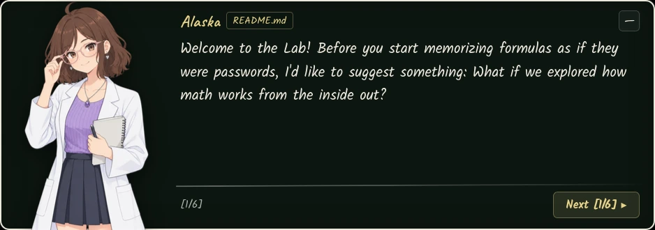

  
  <h1>Alaska Math Lab</h1>
  
<strong>Interactive first-principles math laboratories featuring conceptual diagnosis, experimental exploration, and an evolving adaptive learning architecture.</strong>

  
  
  
  

Alaska Math Lab is a local-first web laboratory for learning college-entry mathematics and introductory Analysis concepts. Its purpose is to help learners understand why mathematical ideas work, experiment with their consequences, recognize reasoning errors, and transfer what they have learned to new problems.

Instead of presenting rules as isolated recipes, the project represents mathematical structures through manipulable objects: logic circuits, dimensional connectors, number lines, sequence ribbons, Cartesian planes, mirrors, curves, and exponential models.

The experience combines three layers:

- **Mathematical laboratories:** simulators and interactive representations that make abstract relationships observable.
- **Narrative guidance:** Alaska, a Visual Novel engine tutor, guides explanations, hints, and diagnostics whenever her intervention adds value.
- **Durable learning:** a pedagogical architecture in development that organizes active retrieval, spaced practice, interleaving, metacognition, and transfer.

**The goal is not to maximize screen time, streaks, or click counts. It is to develop independent mathematical reasoning that persists beyond each session.**

---

## Project Status

The repository combines implemented capabilities with a learning architecture that still needs to be built in stages. This distinction is deliberate: a documented specification does not equate to an available feature.

| Area | Current Status |
|---|---|
| Interactive laboratories and SVG boards | Implemented in the modules published on the hub |
| AST-based algebraic evaluators | Implemented in modules that accept formulas |
| Conceptual error diagnostics | Implemented for a specific catalog of errors per module |
| Visual Novel tutor, scripts, poses, and procedural audio | Implemented |
| Contextual glossary and working scratchpad | Implemented in the modules that integrate them |
| Local progress by section | Implemented in specific modules |
| Core competency and mastery engine | Planned |
| Adaptive spaced repetition | Planned |
| Global interleaved practice selection | Planned |
| Metacognitive confidence calibration | Planned |
| Longitudinal error atlas | Planned |
| Persistent and autonomous base camp | Future exploration |
| Bosses as integrative assessments | Design direction; unified engine pending |

Detailed implementation status and task dependencies are maintained in [ROADMAP.md](ROADMAP.md). The target pedagogical architecture, its foundations, and scientific references are in [LEARNING_ARCHITECTURE.md](LEARNING_ARCHITECTURE.md).

## What It Currently Offers

The hub features seven laboratories:

| Laboratory | Entry Point | Focus |
|---|---|---|
| Compound Inequalities | [desigualdades.html](desigualdades.html) | Inequalities as series and parallel circuits, polarity inversion, intervals, and solution sets. |
| Units and Dimensional Analysis | [unidades.html](unidades.html) | Factor-based conversion, dimensional connectors, equivalent operations, and the multiplicative identity. |
| Functions | [funciones.html](funciones.html) | Uniqueness, domain and range, positivity sets, monotonicity, secant line, and inverse function. |
| Sequences | [sucesiones.html](sucesiones.html) | Arithmetic and geometric sequences, recursive and explicit rules, step counting, signs, and limits. |
| Absolute Value and Piecewise Functions | [valor-absoluto.html](valor-absoluto.html) | Distance, vertex, transformations, branches, domain, range, boundaries, and uniqueness. |
| Powers and Roots | [potencias-raices.html](potencias-raices.html) | Exponents, roots, properties, domain restrictions, and relationships between representations. |
| Exponential Functions | [exponenciales.html](exponenciales.html) | Growth and decay, base, initial factor, tables, models, and asymptotes. |

The Units page also retains an alternative entry point in the repository: [laboratorio_unidades.html](laboratorio_unidades.html). The main hub navigation currently uses **unidades.html**.

### Mathematical Principles of the Project

- **First principles before tricks:** explain transformations through properties and equivalences, not through phrases like “move it to the other side and flip the sign.”
- **Equivalence before text matching:** when supported by the module, formulas are parsed via syntax trees and compared mathematically.
- **Diagnosis before a red cross:** known errors must be associated with a conceptual hypothesis and a useful intervention.
- **Meaningful manipulation:** moving an object must allow observing a mathematical relationship, not serve as an inconsequential animation.
- **Formal precision:** graphs, domains, boundaries, signs, and results must preserve their mathematical meaning.
- **Gradual fading of scaffolding:** guidance must lead to independent problem-solving, not create dependence on the interface or on Alaska.

## How Learning Should Work

The target architecture follows a cycle that connects exploration and consolidation:

1. **Predict:** formulate a hypothesis before revealing the outcome.
2. **Experiment:** modify variables or objects within a widget.
3. **Observe:** identify what changes, what remains invariant, and why.
4. **Formalize:** connect the observation with definitions, properties, and symbolic expressions.
5. **Practice:** solve problems with scaffolding that fades progressively.
6. **Retrieve:** reuse the concept after an interval.
7. **Transfer:** apply it to a new problem with a different appearance or representation.

Not every activity must contain all stages. The sequence adapts to the concept, prior knowledge, and learning state.

The complete architecture is specified in [LEARNING_ARCHITECTURE.md](LEARNING_ARCHITECTURE.md). Its core strategies include active retrieval, spaced practice, interleaving, worked examples with faded steps, method comparison, self-explanation, confidence calibration, and translation across representations.

## Alaska: Tutor, Not a Substitute for Reasoning

Alaska is a narrative presence designed to intervene contextually:

- Explains a prerequisite when she detects a gap.
- Points out which property or step needs review.
- Switches representations when an explanation falls short.
- Offers graduated hints without immediately revealing the solution.
- Recognizes specific mathematical strategies, not just correct answers.
- Steps back when the student can continue autonomously.

Her personality can be ironic, expressive, and tsundere. Humor must never turn into humiliation, pressure, guilt, or evaluation of the student's personal ability.

## Technical Architecture

The project uses HTML, CSS, and native JavaScript modules, with zero runtime dependencies. It does not use UI frameworks, external graphing libraries, eval(), or new Function().

Mathematical logic is separated from rendering and DOM events. In modules that require it, expressions are parsed as ASTs and validators work on mathematical structures instead of comparing strings.

### Shared Core

| File | Responsibility |
|---|---|
| js/core/dom.js | DOM/SVG helpers, mounting, event delegation, and reactive store. |
| js/core/plot.js | Coordinate conversion, SVG boards, and persistent dragging. |
| js/core/math-format.js | Mathematical formatting and es-AR numeric conventions. |
| js/core/vn.js | Visual Novel HUD, dialogue, poses, and Alaska's reactions. |
| js/core/sound.js | Procedural sound synthesis and audio preferences. |
| js/core/nav.js | Global navigation, curriculum menu, and shared controls. |
| js/core/glossary.js | Contextual glossary and term lookup. |
| js/core/scratchpad.js | Auxiliary working scratchpad. |

### Mathematical Modules

- **js/modules/circuitos/**: logic and rendering for compound inequalities.
- **js/modules/dimensional/**: calculation and representation for dimensional analysis.
- **js/modules/funciones/**: uniqueness scanner, X-ray view, secant line, and inverse function.
- **js/modules/potencias-raices/**: logic, parser, components, challenges, and widgets.
- **js/modules/sucesiones/**: logic, parser, diagnostics, challenges, scripts, and widgets.
- **js/modules/valor-absoluto/**: logic, parser, diagnostics, challenges, scripts, and widgets.
- **js/modules/exponenciales/**: lessons, components, parser, challenges, and widgets.

Not all modules share the same lesson, persistence, or validation model yet. The future adaptive architecture must be integrated progressively, without forcing a massive migration or duplicating existing engines.

## Project Documentation

These documents have different responsibilities and should be read together:

| Document | Question Answered | Authority |
|---|---|---|
| [LEARNING_ARCHITECTURE.md](LEARNING_ARCHITECTURE.md) | What learning processes do we want to support and how do we measure them? | Pedagogical decisions, competency model, retrieval, and assessment. |
| [DESIGN_PHILOSOPHY.md](DESIGN_PHILOSOPHY.md) | How should the experience be presented and behave? | Visual identity, interaction, feedback, narrative, and accessibility. |
| [ROADMAP.md](ROADMAP.md) | What is built, in what order, and with what acceptance criteria? | Implementation sequence, dependencies, and work status. |
| README.md | What is the project and what is available today? | Public overview and documentation map; does not replace the specifications above. |

### Instructions for Coding Agents

Before modifying the project:

1. Read this README to recognize the actual state of the repository.
2. Read LEARNING_ARCHITECTURE.md if the change affects exercises, diagnostics, progress, motivation, retrieval, scheduling, or assessment.
3. Read DESIGN_PHILOSOPHY.md if the change affects layout, typography, color, animation, interaction, Alaska, or accessibility.
4. Read ROADMAP.md to check dependencies, priority, status, and acceptance criteria.
5. Inspect the actual files and patterns of the affected module before proposing a new abstraction.

During work:

- Do not present a planned feature as implemented.
- Do not invent scientific results or turn design hypotheses into proven facts.
- Do not alter mathematical semantics to simplify the UI.
- Do not replace tested pure logic with duplicated logic inside a component.
- Do not add runtime dependencies without a technical justification and a documented decision.
- Maintain compatibility with keyboard, touch, screen readers, reduced motion, and narrow screens.
- Prefer incremental changes that can be tested in isolation.
- Update ROADMAP.md when a task's status changes and README.md only when a visible capability or usage instruction changes.
- If a decision affects multiple layers, update the corresponding specification in addition to the code.

Upon completion, report modified files, executed tests, observed results, limitations, and any pending decisions. Never claim a test passed if it was not executed.

## Requirements

| Tool | Usage |
|---|---|
| Python 3 or an equivalent static HTTP server | Serve files and enable native ES modules. |
| Node.js 20+ | Run tests with node --test. |
| Playwright Chromium | Run visual and interaction checks; required only for those scripts. |

## Installation

Clone the repository and serve the root directory:

    python3 -m http.server 8000 --bind 127.0.0.1

Open http://127.0.0.1:8000/ in your browser.

Do not open pages directly with file:// because native ES modules require an HTTP server.

## Testing and Verification

Run the available unit tests:

    node --test tests/sound.test.mjs tests/sucesiones/*.test.mjs tests/valor-absoluto/*.test.mjs

With the server running, execute the Playwright checks:

    BASE_URL=http://127.0.0.1:8000 node scripts/verify-pages.mjs
    BASE_URL=http://127.0.0.1:8000 node scripts/verify-interactions.mjs

The scripts verify aspects such as HTTP responses, console errors, horizontal overflow, interaction, and drag persistence. Commands must be kept synchronized with the scripts and suites that actually exist.

## Printable Study Sheets

The Sequences and Absolute Value lessons include review sheets with print styles to remove interactive controls and produce readable study material. Check each module for the current scope of its export support.