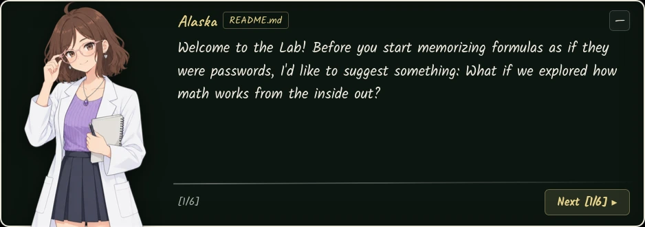

  
  <h1>Alaska Math Lab</h1>
  
<strong>Interactive first-principles math laboratories featuring conceptual diagnosis, experimental exploration, and an evolving adaptive learning architecture.</strong>

  
  
  
  

Alaska Math Lab is a local-first web laboratory for learning college-entry mathematics and introductory Analysis concepts. Its purpose is to help learners understand why mathematical ideas work, experiment with their consequences, recognize reasoning errors, and transfer what they have learned to new problems.

Instead of presenting rules as isolated recipes, the project represents mathematical structures through manipulable objects: logic circuits, dimensional connectors, number lines, sequence ribbons, Cartesian planes, mirrors, curves, and exponential models.

The experience combines three layers:

- **Mathematical laboratories:** simulators and interactive representations that make abstract relationships observable.
- **Narrative guidance:** Alaska, a Visual Novel engine tutor, guides explanations, hints, and diagnostics whenever her intervention adds value.
- **Durable learning:** a pedagogical architecture in development that organizes active retrieval, spaced practice, interleaving, metacognition, and transfer.

**The goal is not to maximize screen time, streaks, or click counts. It is to develop independent mathematical reasoning that persists beyond each session.**

---

## Project Status

The repository combines implemented capabilities with a learning architecture that still needs to be built in stages. This distinction is deliberate: a documented specification does not equate to an available feature.

| Area | Current Status |
|---|---|
| Interactive laboratories and SVG boards | Implemented across all 11 UNMDP Exactas units (15 interactive labs + 2 integrator evaluations) |
| Shared mathematical & UI primitives | Implemented (`js/core/board-kit.js`, `js/core/math/{polynomials,trigonometry}.js`) |
| AST-based algebraic & trig evaluators | Implemented (`expr.js`, `logic.js`, `polynomials.js`, `trigonometry.js`, `transfer-classifiers/shared-ast.js`) |
| Conceptual error diagnostics | Implemented across all 15 modules with normalized taxonomy and contextual Alaska poses |
| Visual Novel tutor, scripts, poses, and procedural audio | Implemented (`js/core/vn.js`, `js/core/sound.js`) |
| Contextual glossary and working scratchpad | Implemented (`js/core/glossary.js`: 54 terms resolving 100% of `data-gloss` tags across 18 pages) |
| Local progress by section & competency | Implemented with unified store (`alaska:learning:v1`) and non-destructive legacy migration |
| Core competency & 2-step DAG engine | Implemented (`curriculum-registry.js`: 15 modules, 88 competencies, acyclic strict-evidence DAG) |
| Adaptive spaced repetition | Implemented (`js/core/learning/scheduler.js` deterministic `review_due` windows) |
| Global interleaved practice selection | Implemented (`js/core/learning/exercise-selector.js`: `excludeUnseen: true` global interleaving & root-cause repair) |
| Modular inter-module transfer engine | Implemented (`transfer.js` + `transfer-classifiers/*`: 8 model families incl. Radical/Irrational, 9 challenge families, strict `unseen` guard) |
| Open Mysteries Notebook & Hub re-entry | Implemented (`js/core/learning/mysteries.js`: 13 entries across Units 01–11, max 5 open, non-mastery invariant; `#hub-reentry` in `index.html`) |
| Longitudinal error atlas | Implemented across all 15 laboratories (`js/core/learning/dashboard.js` `mountCompetencyDashboard`) |
| Metacognitive confidence calibration | Planned |
| Persistent and autonomous base camp | Future exploration |
| Integrative 6-phase boss evaluations | Implemented (`js/core/learning/boss-engine.js`, `jefe-integrador-1.html`, `simulacro-global.html`) |

Detailed implementation status and task dependencies are maintained in [ROADMAP.md](ROADMAP.md). The target pedagogical architecture, its foundations, and scientific references are in [LEARNING_ARCHITECTURE.md](LEARNING_ARCHITECTURE.md).

### Verified Pedagogical & Technical Coverage (11 Units · 15 Labs · 2 Integrators · 88 Competencies)

All 15 unit modules expose `competencies-map.js` + `learning-adapter.js`, uniform 8-tuple metadata on checks and challenges, and `mountCompetencyDashboard` in `#sec-repaso`. Total verified test suite: **650 / 650 PASS** across **115 test files** (`node --test tests/*.test.mjs tests/*/*.test.mjs`) plus 18/18 headless Chromium page & interaction gates.

## What It Currently Offers

The hub (`index.html`, `js/core/nav.js`) spans all **11 units** of the UNMDP FCEyN entry curriculum with **15 laboratories** and **2 untimed 6-phase integrator evaluations**:

| Unit | Laboratory / Evaluation | Entry Point | Focus |
|---|---|---|---|
| U01 · Real Numbers | Powers and Roots | [potencias-raices.html](potencias-raices.html) | Exponents, roots, additive vs. multiplicative worlds, domain restrictions, rationalization. |
| U01 · Real Numbers | Compound Inequalities | [desigualdades.html](desigualdades.html) | Inequalities as series (AND) and parallel (OR) circuits, polarity inversion, Exactas intervals. |
| U01 · Real Numbers | Units and Dimensional Analysis | [unidades.html](unidades.html) | Factor-based conversion, dimensional connectors, powers on units, multiplicative identity `1`. |
| U02 · Functions | Functions | [funciones.html](funciones.html) | Uniqueness scanner, domain and range, positivity sets, monotonicity, secant line, inverse function. |
| U02 · Functions | Absolute Value and Piecewise | [valor-absoluto.html](valor-absoluto.html) | 1D distance (also U01 `#sec-1`), Cartesian mirror, `a|x−h|+k`, piecewise branches, step functions. |
| U02 · Functions | Sequences (Domain in $\mathbb{N}$) | [sucesiones.html](sucesiones.html) | Arithmetic and geometric sequences, recursive vs. explicit rules, fencepost counting, limits. |
| U03 · Linear | Linear Functions & Analytic Geometry | [lineal.html](lineal.html) | Slope $m = \tan(\alpha)$, explicit/implicit/segmentary forms, parallel/perpendicular, midpoint, bisector. |
| U04 · Systems | 2×2 Linear Systems | [sistemas.html](sistemas.html) | Algebraic & graphical solving, SCD / SCI / SI classification, parametric systems, modeling. |
| U05 · Quadratic | Quadratic Functions and Parabolas | [cuadraticas.html](cuadraticas.html) | Area model, factoring, canonical/factored/polynomial forms, completing the square, $\Delta$, Vieta, optimization. |
| U06 · Polynomials | Polynomials, Ruffini & Gauss | [polinomios.html](polinomios.html) | Degree laws, Euclidean division, Ruffini with $(ax-b)$ rescaling, Remainder & Gauss theorems, multiplicity. |
| U07 · Rational & Irrational | Rational & Irrational Functions | [racionales-irracionales.html](racionales-irracionales.html) | Polynomial LCM, domain exclusions, removable holes vs. vertical/horizontal asymptotes, extraneous roots. |
| U08 · Exponential | Exponential Functions | [exponenciales.html](exponenciales.html) | Growth and decay $k \cdot a^x$, natural base $e$, horizontal asymptotes, full analysis, real equations. |
| U09 · Logarithmic | Logarithmic Functions | [logaritmicas.html](logaritmicas.html) | Existence conditions, operational laws, change of base, inverse reflection of $a^x$, equations. |
| U10 · Trig Ratios | Trigonometric Ratios & Geometry | [razones-trigonometricas.html](razones-trigonometricas.html) | Right triangles, Pythagoras, SOHCAHTOA, elevation/depression, sexagesimal vs. radians, arcs & solids. |
| U11 · Trig Functions | Trigonometric Functions | [funciones-trigonometricas.html](funciones-trigonometricas.html) | Congruence classes $C_\alpha$, all 6 trig functions with distinct domains/poles, identities, periodic equations. |
| U01–U06 · Synthesis | Integrative Boss 1 | [jefe-integrador-1.html](jefe-integrador-1.html) | 6-phase integrative assessment (`Reconocer` $\to$ `Debrief`) without countdown timers. |
| U01–U11 · Global | Global Integrative Simulacro | [simulacro-global.html](simulacro-global.html) | Full-curriculum UNMDP synthesis assessment with independent vs. assisted tracking and repair links. |

The Units page also retains a legacy redirect in the repository: [laboratorio_unidades.html](laboratorio_unidades.html). The main hub navigation uses **unidades.html**.

### Mathematical Principles of the Project

- **First principles before tricks:** explain transformations through properties and equivalences, not through phrases like “move it to the other side and flip the sign.”
- **Equivalence before text matching:** formulas, polynomials, intervals, and trigonometric angles are parsed via syntax trees and exact math layers instead of string matching.
- **Diagnosis before a red cross:** known errors are associated with a conceptual hypothesis and a useful intervention.
- **Meaningful manipulation:** moving an object allows observing a mathematical relationship, not serving as an inconsequential animation.
- **Formal precision:** graphs, domains, boundaries, signs, and results preserve their mathematical meaning.
- **Gradual fading of scaffolding:** guidance leads to independent problem-solving, not dependence on the interface or on Alaska.

## How Learning Should Work

The target architecture follows a cycle that connects exploration and consolidation:

1. **Predict:** formulate a hypothesis before revealing the outcome.
2. **Experiment:** modify variables or objects within a widget.
3. **Observe:** identify what changes, what remains invariant, and why.
4. **Formalize:** connect the observation with definitions, properties, and symbolic expressions.
5. **Practice:** solve problems with scaffolding that fades progressively.
6. **Retrieve:** reuse the concept after an interval.
7. **Transfer:** apply it to a new problem with a different appearance or representation.

Not every activity must contain all stages. The sequence adapts to the concept, prior knowledge, and learning state.

The complete architecture is specified in [LEARNING_ARCHITECTURE.md](LEARNING_ARCHITECTURE.md). Its core strategies include active retrieval, spaced practice, interleaving, worked examples with faded steps, method comparison, self-explanation, confidence calibration, and translation across representations.

## Alaska: Tutor, Not a Substitute for Reasoning

Alaska is a narrative presence designed to intervene contextually:

- Explains a prerequisite when she detects a gap.
- Points out which property or step needs review.
- Switches representations when an explanation falls short.
- Offers graduated hints without immediately revealing the solution.
- Recognizes specific mathematical strategies, not just correct answers.
- Steps back when the student can continue autonomously.

Her personality can be ironic, expressive, and tsundere. Humor must never turn into humiliation, pressure, guilt, or evaluation of the student's personal ability.

## Technical Architecture

The project uses HTML, CSS, and native JavaScript modules, with zero runtime dependencies. It does not use UI frameworks, external graphing libraries, `eval()`, or `new Function()`.

Mathematical logic is separated from rendering and DOM events. Expressions, polynomials, intervals, and angles are parsed via dedicated AST and exact-arithmetic layers (`js/core/math/` and `js/modules/*/expr.js`).

### Shared Core (`js/core/`)

| File / Directory | Responsibility |
|---|---|
| `js/core/dom.js` | DOM/SVG helpers, mounting, event delegation, and reactive store. |
| `js/core/plot.js` & `js/core/board-kit.js` | Coordinate conversion, SVG boards, keyboard-accessible `attachSvgDrag`, and 2-stage POE `createPredictBox`. |
| `js/core/math-format.js` | Mathematical formatting (`fmt()` with es-AR comma, unicode minus `−`, horizontal fractions). |
| `js/core/math/{polynomials,trigonometry}.js` | Shared pure exact polynomial/rational/Ruffini/Gauss arithmetic (U06–U07) and exact trigonometry/congruences (U10–U11). |
| `js/core/vn.js` | Visual Novel HUD, dialogue, 17 poses, and Alaska's reactions. |
| `js/core/sound.js` | Procedural sound synthesis (Web Audio API) and audio preferences. |
| `js/core/nav.js` | Global 11-unit / 18-page navigation, curriculum mega-menu, integrator links, and shared controls. |
| `js/core/glossary.js` | Contextual glossary with 54 terms (`GLOSSARY_TERMS`) resolving 100% of `data-gloss` attributes across all pages. |
| `js/core/scratchpad.js` | Auxiliary working scratchpad. |
| `js/core/learning/events.js` | Contract, factory, and validation for immutable `LearningEvent` objects (15 lab modules + 2 integrators). |
| `js/core/learning/competencies.js` & `curriculum-registry.js` | 2-step deterministic global competency registry validating the 15-module / 88-competency acyclic DAG. |
| `js/core/learning/progress-store.js` | Local-first persistence (`alaska:learning:v1`), bounded event log (200 items), `state.mysteries`, and KPI reports. |
| `js/core/learning/mastery.js` | Conservative 7-state pedagogical mastery machine (`unseen` $\to$ `durable`) preventing single-success over-crediting. |
| `js/core/learning/scheduler.js` | Deterministic spaced review scheduler computing review windows (`review_due`). |
| `js/core/learning/exercise-selector.js` | Adaptive selector and global interleaving (`selectGlobalInterleavedBatch`, `excludeUnseen: true`, prerequisite-first repair). |
| `js/core/learning/transfer.js` & `transfer-classifiers/*` | Modular plugin engine for 8 model families (`linear`, `quadratic`, `polynomial`, `rational`, `radical`, `exponential`, `logarithmic`, `trigonometric`) + `shared-ast.js` (0 `js/modules/*` imports, unseen guard). |
| `js/core/learning/mysteries.js` | Open Mysteries Notebook (`OPEN_MYSTERIES`: 13 entries across U01–U11, max 5 open, strict non-mastery invariant, `mountMysteriesNotebook`). |
| `js/core/learning/dashboard.js` | Unified competency & Error Atlas dashboard (`mountCompetencyDashboard`). |
| `js/core/learning/boss-engine.js` | Untimed 6-phase integrative assessment engine (`Reconocer`, `Predecir`, `Modelar`, `Resolver`, `Transferir`, `Debrief`). |
| `js/core/learning/migrations.js` | Non-destructive migration utilities preserving existing legacy localStorage keys across homogenized modules. |

### Mathematical Modules (`js/modules/`)

- **Unit 01:** `potencias-raices/`, `circuitos/` (`desigualdades.html`), `dimensional/` (`unidades.html`).
- **Unit 02:** `funciones/`, `valor-absoluto/`, `sucesiones/`.
- **Unit 03:** `lineal/`.
- **Unit 04:** `sistemas/`.
- **Unit 05:** `cuadraticas/`.
- **Unit 06:** `polinomios/`.
- **Unit 07:** `racionales-irracionales/`.
- **Unit 08:** `exponenciales/`.
- **Unit 09:** `logaritmicas/`.
- **Unit 10:** `razones-trigonometricas/`.
- **Unit 11:** `funciones-trigonometricas/`.
- **Integrators:** `jefes/integrador-1.js` (`jefe-integrador-1.html`) and `jefes/simulacro-global.js` (`simulacro-global.html`).

All 15 unit modules share a unified pedagogical contract (`competencies-map.js`, `learning-adapter.js`, uniform 8-tuple metadata, `mountCompetencyDashboard`, and `alaska:learning:v1`), while retaining domain-specific interactive visualizations and parsers.

## Project Documentation

These documents have different responsibilities and should be read together:

| Document | Question Answered | Authority |
|---|---|---|
| [LEARNING_ARCHITECTURE.md](LEARNING_ARCHITECTURE.md) | What learning processes do we want to support and how do we measure them? | Pedagogical decisions, competency model, retrieval, and assessment. |
| [DESIGN_PHILOSOPHY.md](DESIGN_PHILOSOPHY.md) | How should the experience be presented and behave? | Visual identity, interaction, feedback, narrative, and accessibility. |
| [ROADMAP.md](ROADMAP.md) | What is built, in what order, and with what acceptance criteria? | Implementation sequence, dependencies, and work status. |
| README.md | What is the project and what is available today? | Public overview and documentation map; does not replace the specifications above. |

### Instructions for Coding Agents

Before modifying the project:

1. Read this README to recognize the actual state of the repository.
2. Read LEARNING_ARCHITECTURE.md if the change affects exercises, diagnostics, progress, motivation, retrieval, scheduling, or assessment.
3. Read DESIGN_PHILOSOPHY.md if the change affects layout, typography, color, animation, interaction, Alaska, or accessibility.
4. Read ROADMAP.md to check dependencies, priority, status, and acceptance criteria.
5. Inspect the actual files and patterns of the affected module before proposing a new abstraction.

During work:

- Do not present a planned feature as implemented.
- Do not invent scientific results or turn design hypotheses into proven facts.
- Do not alter mathematical semantics to simplify the UI.
- Do not replace tested pure logic with duplicated logic inside a component.
- Do not add runtime dependencies without a technical justification and a documented decision.
- Maintain compatibility with keyboard, touch, screen readers, reduced motion, and narrow screens.
- Prefer incremental changes that can be tested in isolation.
- Update ROADMAP.md when a task's status changes and README.md only when a visible capability or usage instruction changes.
- If a decision affects multiple layers, update the corresponding specification in addition to the code.

Upon completion, report modified files, executed tests, observed results, limitations, and any pending decisions. Never claim a test passed if it was not executed.

## Requirements

| Tool | Usage |
|---|---|
| Python 3 or an equivalent static HTTP server | Serve files and enable native ES modules. |
| Node.js 20+ | Run tests with node --test. |
| Playwright Chromium | Run visual and interaction checks; required only for those scripts. |

## Installation

Clone the repository and serve the root directory:

    python3 -m http.server 8000 --bind 127.0.0.1

Open http://127.0.0.1:8000/ in your browser.

Do not open pages directly with file:// because native ES modules require an HTTP server.

## Testing and Verification

Run the available unit tests:

    node --test tests/*.test.mjs tests/*/*.test.mjs

With the server running, execute the Playwright checks:

    BASE_URL=http://127.0.0.1:8000 node scripts/verify-pages.mjs
    BASE_URL=http://127.0.0.1:8000 node scripts/verify-interactions.mjs

The scripts verify aspects such as HTTP responses, console errors, horizontal overflow, interaction, and drag persistence. Commands must be kept synchronized with the scripts and suites that actually exist.

## Printable Study Sheets

The Sequences and Absolute Value lessons include review sheets with print styles to remove interactive controls and produce readable study material. Check each module for the current scope of its export support.

## Licensing & Intellectual Property (Split Licensing)

This project uses a split licensing model to separate the technical source code from its narrative identity and pedagogical content:

1. **Source Code & Technical Engine (`js/`, `css/`, `scripts/`, `tests/`):**
   Distributed under the terms of the **GNU Affero General Public License v3.0 (AGPLv3)**. See the [LICENSE](LICENSE) file for details.

2. **Pedagogical Content & Lesson Prose (`*.html`, `*.md`, scripts):**
   Licensed under **[Creative Commons Attribution-NonCommercial-ShareAlike 4.0 International (CC BY-NC-SA 4.0)](https://creativecommons.org/licenses/by-nc-sa/4.0/)**. You are free to share and adapt this material for non-commercial educational purposes, provided you give appropriate credit to **Alaska Math Lab**.

3. **Character "Alaska" & Visual Assets (`assets/vn/`, `assets/github/`):**
   © 2026 Alaska45l. **All rights reserved.** The character design of Alaska, her expression sprites (`assets/vn/*.webp`), chibi variants, and conceptual art are included in this repository strictly for the execution and visualization of this educational web lab. Independent redistribution, modification, AI model training, or use in third-party products (commercial or otherwise) is strictly prohibited without explicit written consent.
